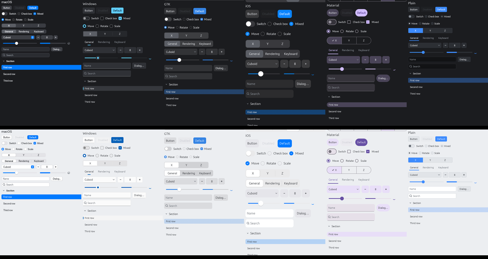

# egui_native_look



egui controls drawn the way macOS, Windows, GNOME, iOS and Android draw theirs.
Everything stays egui, so it runs wherever egui runs; the app keeps its own palette and
layout.

| Look | Style | Controls | Text | Accent |
| --- | --- | --- | --- | --- |
| `Mac` | SwiftUI / AppKit | 22 pt | San Francisco | System Settings |
| `Windows` | WinUI 3 / Fluent 2 | 32 px | Segoe UI Variable | Personalization |
| `Gtk` | GTK 4 / libadwaita | 34 px | Adwaita Sans, Cantarell | GNOME accent |
| `Ios` | SwiftUI / UIKit | 44 pt | the app's | systemBlue |
| `Material` | Material 3 | 40 dp | Roboto if present | baseline primary |
| `Plain` | the app's own | 28 | the app's | the app's |

`Look::system()` picks by target; the web gets `Plain`. `Look::touch()` gives
finger-sized controls (iOS or Material) where `touch_screen()` says there is one, a
tablet's browser too, and `Metrics::scaled` makes any look larger or smaller.

## Use

```toml
[dependencies]
egui_native_look = { git = "https://github.com/MojzisekJan/egui_native_look" }
```

The default `system` feature reads the system: its accent, its scheme, its fonts and
whether the screen takes touch. `default-features = false` leaves it out, for an app
that wants the controls alone; the looks then keep their own accents.

```rust
use egui_native_look as look;

// Once.
let mut fonts = egui::FontDefinitions::default();
look::install_fonts(&mut fonts, look::Look::system());
ctx.set_fonts(fonts);
look::install(&ctx, look::Theme::system());

// Once a frame: picks up a change of the system's accent and scheme.
look::follow_system(&ctx);

// In the UI. The scheme follows egui's (ctx.set_theme).
ui.add(look::Button::new("Save").accent());
ui.add(look::Switch::new(&mut wireframe));
ui.add(look::Checkbox::new(&mut snap, "Snap to grid"));
look::radio_value(ui, &mut tool, Tool::Move, "Move");
ui.add(look::Segmented::new("axis", &mut axis, &["X", "Y", "Z"]));
ui.add(look::Dropdown::new("shape", &mut shape, &["Cuboid", "Sphere"]));
ui.add(look::NumberField::new(&mut radius).range(0.0..=1024.0));
ui.add(look::Slider::new(&mut volume, 0.0..=100.0));
ui.add(look::TextField::new(&mut name).hint("Name"));
look::section(ui, "layers", "Layers", true, |ui| { /* … */ });
ui.add(look::IconButton::new("#").selected(grid).tooltip("Grid"));
ui.add(look::ColorWell::new(&mut tint));
look::Form::new("fillet").show(ui, |form| {
    form.row("Radius", |ui| ui.add(look::NumberField::new(&mut radius).range(0.0..=1024.0)));
    form.row("Snap", |ui| ui.add(look::Switch::new(&mut snap)));
});
look::Dialog::new("export", "Export").show(&ctx, &mut open, |ui| { /* body */ }, |ui| { /* buttons */ });
look::toast(&ctx, "Map saved"); // drawn by look::show_toasts(&ctx), once a frame
```

Also: `PopupButton` with a list of the app's own (`menu_value`, `submenu`), `combo_icon`
for egui's `ComboBox`, `Tabs` or one `Tab` at a time in a `TabBar`, `Section`,
`ToolWindow` and `window_frame` for floating windows, `ListRow`, `MenuItem`, `ProgressBar`, `Spinner`, `TitleBar` for an
undecorated window, and `shortcut_text` (⇧⌘S or Ctrl+Shift+S). A `Form` lines its labels
up the look's way: right-aligned on macOS, left on Windows, a boxed list in libadwaita
and on iOS. `Theme` takes the app's
palette (`Schemes`, each scheme's `Palette` changed from `Palette::of(dark)` where only
a few colours differ) and sizes (`Metrics`); `install` leaves the rest of egui's style
(shadows, spacing, the heading, the text colour) as the app set it, bar the body and
button text styles, which take `Metrics::body`; `colors(ctx)` gives the resolved colours for the
app's own drawing; the painting functions (`paint_button`, `focus_ring`, ...) are public.

Text is centred on its capitals rather than on egui's line box, so labels sit in the
middle of their controls at every size (`text`, `galley_top`, `entry_margin`).

## Examples and tests

- `cargo run --example gallery [mac|windows|gtk|ios|material|plain] [light] [toast]`
- `cargo test` clicks every control in every look, and tries the keyboard, the names a
  screen reader hears and values out of bounds.
- `cargo test --test snapshots -- --include-ignored` compares each look, dark and light,
  with the pictures in `tests/snapshots` (`UPDATE_SNAPSHOTS=1` to accept a change). It
  renders with wgpu, so it needs a GPU or a software adapter, and a plain `cargo test`
  leaves it out.
- `cargo doc --open` documents every control; `CHANGELOG.md` lists what changed.
- `cargo bench` times a frame of 200 rows of controls in each look against egui's own.

Requires egui 0.36 and Rust 1.95.

## Licence

[MIT-0](LICENSE): use, change and ship it anywhere, commercially or not, with no credit
or notice required.
